# Earth Information Jukebox

A web-based interactive jukebox that pairs NASA Earth Information Center visualizations with real-time dynamic sonifications generated from decoded physical data values.

[](https://react.dev/) [](https://www.typescriptlang.org/) [](https://vitejs.dev/) [](https://threejs.org/) [](https://tonejs.github.io/) [](https://tailwindcss.com/) [](https://www.python.org/) [](https://vercel.com/) [](LICENSE)

[Live Demo](<DEPLOYED_URL>) | [Demo Video](<VIDEO_URL>) | [Space Apps Project Page](<PROJECT_URL>)

## Demo


<!--
Media capture instructions for the team:
- docs/assets/hero.png: Capture desktop interface showing the 3D globe with GHRSST sea surface temperature, the active scan-line over the Pacific Ocean, and the deck transport controls.
- docs/assets/sweep.png: Capture Sweep Mode in action, showing the scan-line traversing west to east with active polyphonic voice activity.
- docs/assets/timelapse.png: Capture Time-lapse Mode with the year slider cycling through 2004-2024 and the trend chart visible.
- docs/assets/touch.png: Capture Touch Mode with a mouse hover or keyboard focus reticle over a specific coordinate, displaying numeric readout and reference tone prompt.
- docs/assets/demo.gif: Record a 15-second screen capture demonstrating audio activation, track selection, sweep playback, and touch probing.
-->

| Sweep Mode | Time-lapse Mode | Touch Mode |
| --- | --- | --- |
|  |  |  |
| West-to-east scan-line sonifying real-time data columns | Annual step progression tracking changes from 2004 to 2024 | Point inspection via pointer or keyboard navigation |


## Table of Contents

- [The Challenge](#the-challenge)
- [Our Approach](#our-approach)
- [Features](#features)
- [How It Works](#how-it-works)
  - [Data Pipeline](#data-pipeline)
  - [Sonification Design](#sonification-design)
  - [Runtime Execution](#runtime-execution)
  - [Application State](#application-state)
- [Tracks](#tracks)
- [Architecture](#architecture)
- [Accessibility](#accessibility)
- [Getting Started](#getting-started)
- [Project Workflow](#project-workflow)
- [Hackathon Timeline](#hackathon-timeline)
- [Deployment](#deployment)
- [Team](#team)
- [NASA Data and References](#nasa-data-and-references)
- [AI Tools Used](#ai-tools-used)
- [Limitations and Future Work](#limitations-and-future-work)
- [License and Acknowledgements](#license-and-acknowledgements)

## The Challenge

NASA's Earth Information Center (EIC) generates visual representations of planetary systems, tracking shifts in oceans, vegetation, ice cover, and wildfire activity. However, visual interfaces alone restrict access for individuals who are blind, visually impaired, or neurodivergent. The NASA Space Apps Challenge 2026 challenge ["The Earth Information Jukebox"](<CHALLENGE_URL>) calls for solutions that integrate EIC visualization frames with dynamic, real-time sonifications. The objective is to make Earth science accessible through structured, multi-sensory data interaction.

## Our Approach

Earth Information Jukebox is a client-side browser application structured like a physical jukebox. Each selectable track corresponds to a validated NASA Earth observation dataset. An interactive 3D globe renders the geospatial layer while a vertical scan line moves from west to east, converting decoded numerical data values under the needle into audio synthesis events.

A core technical requirement of this project is scientific fidelity. Audio parameters derive strictly from physical measurements (degrees Celsius, vegetation index ratios, percentage ice coverage) rather than display pixel brightness. The system reverses NASA Global Imagery Browse Services (GIBS) colormap palettes into floating-point numerical matrices, ensuring that what the user hears directly reflects physical Earth observations.

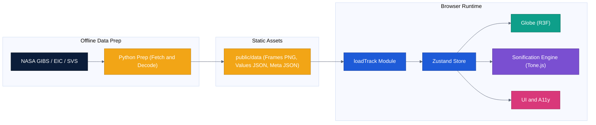
Figure 1: System architecture showing offline data preparation, static deployment assets, and browser runtime modules.

## Features

### Listening Modes
- Sweep Mode: A vertical scan-line traverses from west (-180 deg) to east (+180 deg) across the globe, sonifying data columns into spatial audio chords.
- Time-lapse Mode: Automatically steps through annual frames from 2004 to 2024, running one complete longitudinal sweep per year to convey temporal trends.
- Touch Mode: Direct spatial interrogation enabling users to hover or focus on specific geographic coordinates via pointer or keyboard to hear exact values and reference comparisons.

### Data
- Colormap Inversion: Decodes RGB display pixels back into physical measurements (degrees Celsius, NDVI index, sea ice percentage).
- Downsampled Matrices: Processes 1440x720 satellite imagery into 180x90 discrete floating-point numerical grids (2-degree spatial resolution).
- Trend Summaries: Calculates global and longitudinal mean averages per frame to drive baseline deviation audio filters.
- Curated NASA Catalog: Includes sea surface temperature, vegetation index, sea ice concentration, and thermal anomaly records.

### Accessibility
- Keyboard First: Full keyboard control for transport, track selection, coordinate exploration, and audio muting.
- Screen Reader Support: Real-time status updates and value readouts dispatched through ARIA live regions.
- Audio Captions: Synchronized on-screen text describing acoustic pitch, active instruments, and data values.
- WCAG AA Contrast: UI components and text meet WCAG 2.1 AA contrast thresholds.
- Reduced Motion: Respects the `prefers-reduced-motion` system setting by disabling camera rotations and easing scan-line transitions.
- Reference Tones: Audio legend buttons allowing users to play calibration tones corresponding to minimum, baseline, and maximum values.

## How It Works

### Data Pipeline

NASA GIBS serves map tiles styled with specific scientific color lookup tables (LUTs). The data preparation pipeline ingests full-resolution equirectangular raster frames and reconstructs the underlying scalar fields using published colormap specifications.

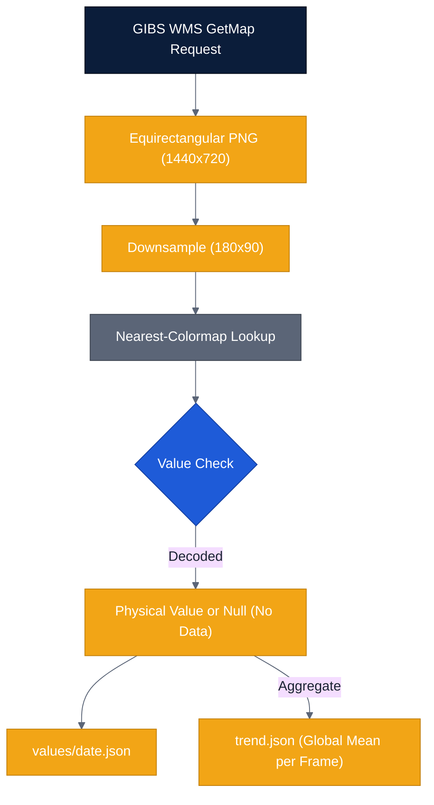
Figure 2: Data pipeline converting GIBS raster imagery into downsampled numerical grids and annual trend summaries.

1. Fetch: An automated Python script executes WMS GetMap requests to GIBS for equirectangular projections (1440x720 pixels) matching exact historical dates (2004 to 2024).
2. Downsample: Images are downsampled to a 180x90 matrix using area-averaging interpolation to create a 2-degree longitude and latitude grid.
3. Colormap Lookup: For each pixel, an exact nearest-neighbor search matches the RGB triplet against the official GIBS XML colormap definition.
4. Numerical Output: Matched entries yield physical values with units (deg C, NDVI, % concentration). Missing data, masked land, or cloud fills resolve to null.
5. Export: Data exports as lightweight static JSON arrays (`values/<date>.json`), alongside precalculated global and longitudinal means (`trend.json`).


Figure 3: Colormap decoding detail translating raw pixel colors into normalized acoustic parameters.

### Sonification Design

The sonification engine translates spatial and temporal scientific measurements into sound using Tone.js and the Web Audio API.

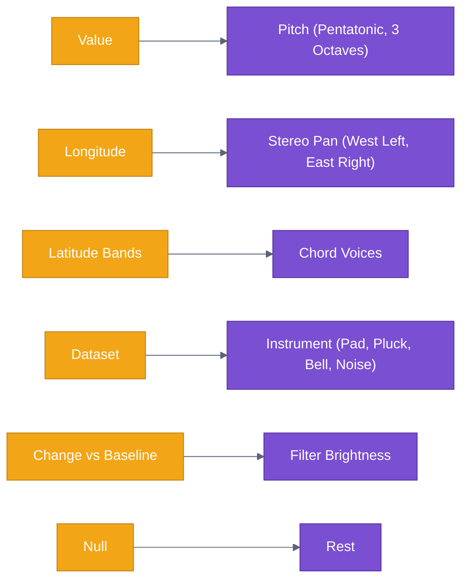
Figure 4: Sonification mapping rules translating physical Earth variables into multi-voice audio parameters.

| Data property | Sound parameter | Rationale |
| --- | --- | --- |
| Physical Value | Pitch (pentatonic scale, 3 octaves) | Constrains pitch to harmonious musical intervals, avoiding dissonance while distinguishing values. |
| Longitude (-180 to +180 deg) | Stereo Pan (left -1.0 to right +1.0) | Provides spatial orientation matching the needle's physical transit across the globe. |
| Latitude Bands (90N to 90S) | Chord Voices (polyphonic layers) | Slices the scan line into distinct latitude bands so polar and equatorial conditions sound concurrently. |
| Dataset Category | Instrument Timbre (pad, pluck, bell, noise) | Assigns distinct acoustic identities reflecting dataset nature (fluid ocean pads vs transient fires). |
| Change vs Baseline | Filter Cutoff Brightness | Shifts harmonic cutoff higher when values exceed historical baselines, highlighting warming anomalies. |
| Null / Void | Rest (silence) | Distinguishes absence of measurement or masked terrain (e.g., continents in ocean tracks) from zero values. |

### Runtime Execution

Audio generation synchronizes directly with three.js rendering and Tone.Transport scheduling.

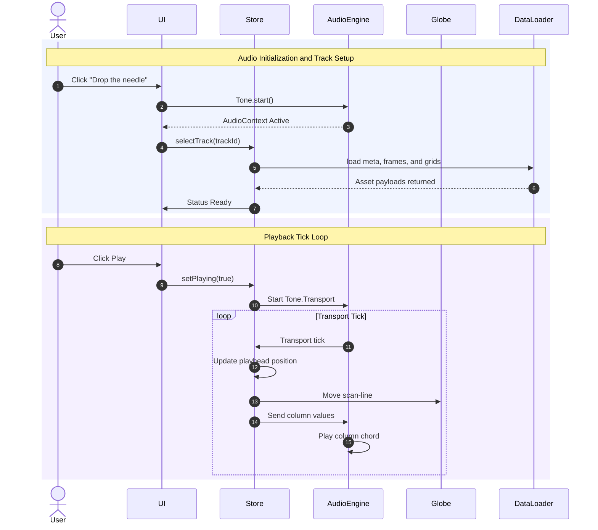
Figure 5: Runtime sequence showing audio unlock, asset loading, and the synchronous playback tick loop.

### Application State

The user interface, 3D visualization, and audio engine derive state through a centralized Zustand store.

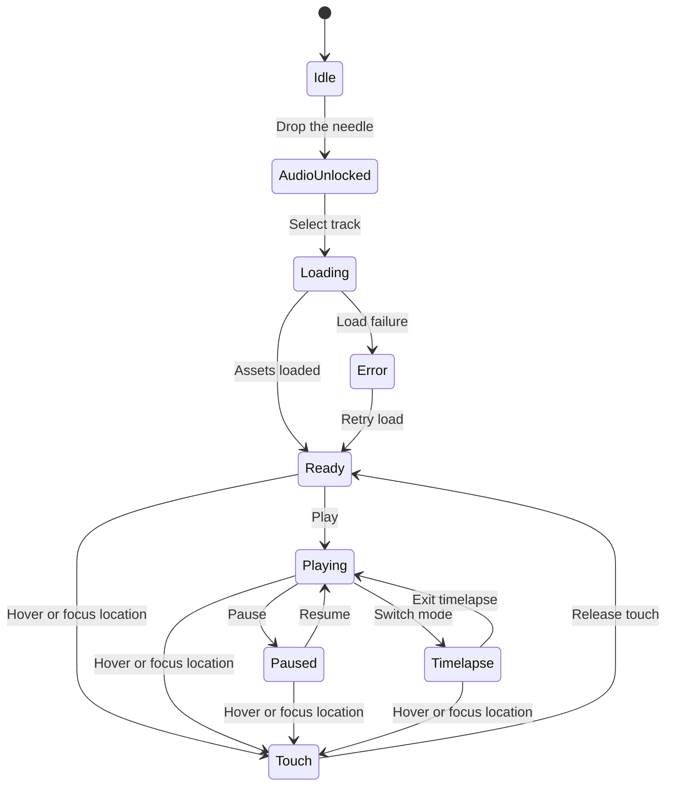
Figure 6: Finite state machine governing audio unlock, asset loading, playback modes, and interactive touch probing.

## Tracks

| Track | NASA dataset | GIBS layer id | Unit | Years | Instrument |
| --- | --- | --- | --- | --- | --- |
| Ocean Fever | GHRSST MUR Sea Surface Temperature | `GHRSST_Sea_Surface_Temperature_Mur` (placeholder) | deg C | 2004-2024 | Warm Synth Pad |
| Breathing Planet | MODIS Terra NDVI (Vegetation Index) | `MODIS_Terra_NDVI_Monthly` (placeholder) | Index (-0.2 to 1.0) | 2004-2024 | Acoustic Pluck |
| Melting Crown | Sea Ice Concentration | `Sea_Ice_Concentration_Daily` (placeholder) | % Concentration | 2004-2024 | Crystal Bell |
| Fire Season (stretch goal) | MODIS/VIIRS Thermal Anomalies | `MODIS_Thermal_Anomalies_All` (placeholder) | Count / MW | 2004-2024 | Granular Noise Percussion |

## Architecture

The system coordinates visualization, audio synthesis, and accessibility through a decoupled component tree and state model.

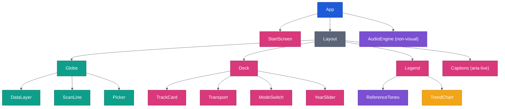
Figure 7: Component hierarchy showing visual elements, three.js canvas components, and the background audio engine.

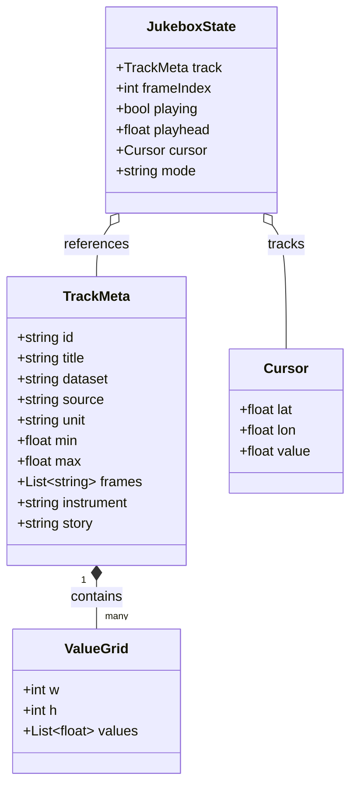
Figure 8: Core data schema specifying metadata structures, numerical matrices, and application state models.

### Directory Structure

```
earth-information-jukebox/
├── docs/
│   └── assets/                     # Hero visual, interface screenshots, and workflow animation
├── public/
│   ├── data/
│   │   └── <track-id>/             # Dataset asset bundles per track
│   │       ├── frames/             # Equirectangular display textures (1440x720 PNG)
│   │       ├── values/             # Calibrated numerical data grids (180x90 JSON)
│   │       ├── meta.json           # Track ranges, physical units, and colormap tables
│   │       └── trend.json          # Historical global annual averages (2004-2024)
│   └── textures/                   # Base globe landmask and topography normal textures
├── scripts/
│   ├── fetch_gibs.py               # Downloads WMS frames from NASA GIBS API
│   ├── decode_colormap.py          # Decodes RGB pixels to physical measurements
│   ├── generate_trends.py          # Computes longitudinal and annual means
│   └── requirements.txt            # Python dependencies (requests, Pillow, numpy)
├── src/
│   ├── app/                        # Application bootstrap, routing, and primary shell
│   ├── audio/                      # Tone.js synths, musical scale mappings, and transport sync
│   ├── data/                       # Asynchronous asset loaders and grid query functions
│   ├── globe/                      # Three.js / R3F sphere, scan-line mesh, and raycaster picker
│   ├── store/                      # Zustand central state store and action reducers
│   └── ui/                         # Deck transport controls, accessibility legend, and ARIA views
├── package.json
├── tailwind.config.js
├── tsconfig.json
└── vite.config.ts
```

## Accessibility

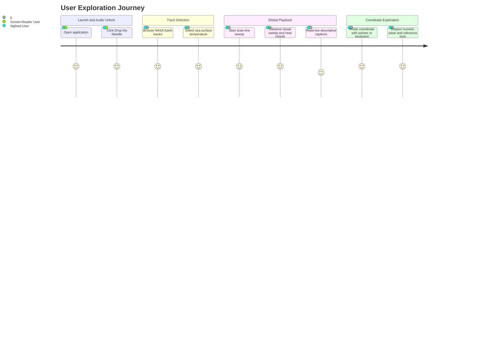
Figure 9: User journey comparing sighted and screen-reader workflows across exploration phases.

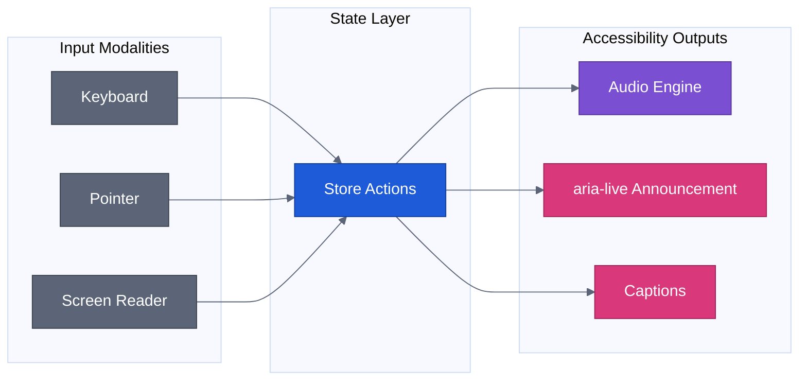
Figure 10: Input routing from diverse modalities into centralized state actions and coordinated accessible outputs.

### Keyboard Shortcuts

| Shortcut | Action | Description |
| --- | --- | --- |
| `Space` | Play / Pause | Starts or halts the west-to-east scan sweep |
| `Left` / `Right` | Move cursor longitude | Steps the inspection cursor westward or eastward across the grid |
| `Up` / `Down` | Change year | Decrements or increments the historical dataset year (2004 to 2024) |
| `1` - `4` | Select track | Directly switches active track (1: SST, 2: NDVI, 3: Sea Ice, 4: Fire) |
| `M` | Mute | Toggles master audio output on and off |
| `?` | Help | Displays keyboard navigation instructions and shortcuts |

### Accessible Interaction Standards
- Screen Reader Announcements: Dynamic status changes dispatch via `aria-live="polite"` regions. Mode updates, dataset switches, and transport stops are read aloud automatically.
- Audible Captions: An active captions panel converts the current sonification into natural language descriptions (e.g., "Pacific Ocean: Low-mid pitch cluster, temperature 22.4 deg C").
- Reduced Motion: System queries via `prefers-reduced-motion` disable camera rotation animations and replace continuous needle motion with discrete interval updates.
- Reference Tones: Audio legend buttons allow users to hear calibration pitches corresponding to min, median, and max values, enabling accurate pitch-to-value interpretation without sight.
- Color Contrast: All UI elements meet WCAG 2.1 AA standards, maintaining contrast ratios of at least 4.5:1 for normal text and 3:1 for graphical controls.

## Getting Started

### Prerequisites
- Node.js 20.0 or higher
- npm 9.0 or higher
- Python 3.10 or higher (required for offline data regeneration)

### Installation
1. Clone the repository:
   ```bash
   git clone <REPO_URL>
   cd earth-information-jukebox
   ```
2. Install frontend JavaScript dependencies:
   ```bash
   npm install
   ```
3. Install Python dependencies for data preprocessing:
   ```bash
   pip install -r scripts/requirements.txt
   ```

### Running Locally
Start the Vite local development server:
```bash
npm run dev
```
Open `http://localhost:5173` in a modern browser supporting the Web Audio API.

### Data Regeneration
To fetch fresh frames directly from NASA GIBS and rebuild decoded value matrices:
```bash
# Fetch raw GIBS equirectangular images for Sea Surface Temperature
python scripts/fetch_gibs.py --track sst

# Decode pixel colors into physical floating-point matrices
python scripts/decode_colormap.py --track sst
```

### Production Build
Compile TypeScript and bundle production assets:
```bash
npm run build
```
Preview the production build locally:
```bash
npm run preview
```

## Project Workflow

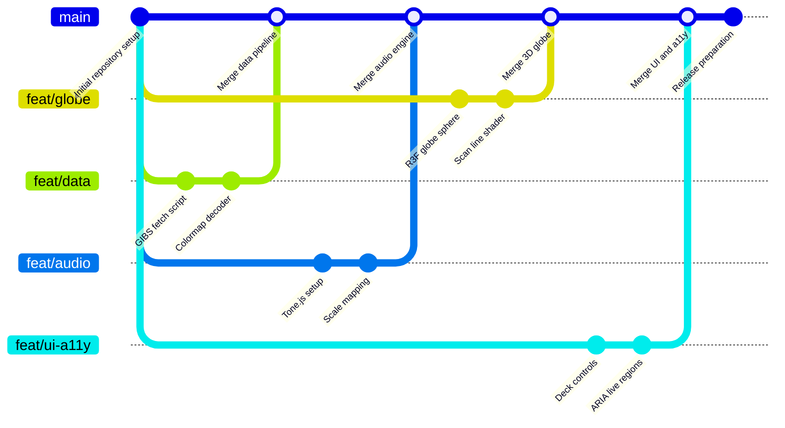
Figure 11: Git branching and integration workflow across core engineering submodules.

### Branch and PR Rules
- Branch Naming: All development occurs on isolated branches prefixed with `feat/`, `fix/`, or `docs/`.
- Pull Requests: Branches merge into `main` strictly through pull requests. Each pull request requires verification of type checking (`npm run type-check`) and production build passing (`npm run build`).
- Merge Strategy: Pull requests are squash-merged into `main` to maintain a readable linear history.
- Commit Conventions: Commits follow the Conventional Commits specification:
  - `feat:` New user-facing or runtime capabilities
  - `fix:` Bug fixes or data alignment corrections
  - `docs:` Documentation and architecture diagrams
  - `refactor:` Code improvements without functional modifications
  - `chore:` Dependency and build configuration updates

## Hackathon Timeline

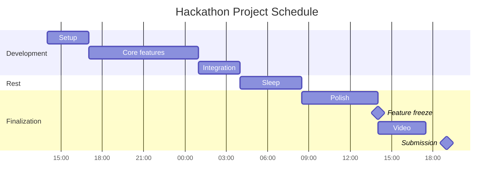
Figure 12: Hackathon development timeline and milestones.

## Deployment

```mermaid
%%{init: {'theme':'base','themeVariables':{'fontFamily':'Inter, Arial','lineColor':'#5B6577','primaryTextColor':'#1B2333'}}}%%
flowchart LR
    classDef neutral fill:#5B6577,stroke:#3D4450,color:#FFFFFF;
    classDef state fill:#1E5BD8,stroke:#143FA0,color:#FFFFFF;
    classDef globe fill:#0E9F8A,stroke:#096E5F,color:#FFFFFF;
    classDef ui fill:#D9387A,stroke:#A12458,color:#FFFFFF;

    PUSH["Push to Feature Branch"]:::neutral
    PR["Pull Request"]:::neutral
    CI["CI Build Check"]:::state
    MERGE["Merge to Main"]:::neutral
    BLD["Vercel Production Build"]:::globe
    URL["Production Deployment (<DEPLOYED_URL>)"]:::ui

    PUSH --> PR
    PR --> CI
    CI --> MERGE
    MERGE --> BLD
    BLD --> URL
```
Figure 13: Continuous deployment pipeline from branch pull request to Vercel production build.

The application compiles to a static client bundle and deploys through Vercel. Static JSON grids and texture maps are served with aggressive immutable cache headers (`Cache-Control: public, max-age=31536000, immutable`), ensuring zero latency during track transitions and playback scrubbing.

## Team

| Name | Role | Area of the codebase |
| --- | --- | --- |
| Aditya | Team Lead, Integration, App Shell, Deployment | `src/app`, `src/store`, build system, and hosting configuration |
| Aarav | 3D Globe Specialist | `src/globe`, Three.js shaders, scan-line visualization, and camera controls |
| Avidan | NASA Data Pipeline Engineer | `scripts/`, `src/data`, GIBS API fetching, and colormap decoding |
| Swanand | Sonification Engine Developer | `src/audio`, Tone.js audio graph, scale quantizer, and synthesizer patches |
| Neil | UX, Accessibility, Video, and Documentation Lead | `src/ui`, ARIA implementation, accessible captions, documentation, and demo video |

## NASA Data and References

| Dataset | Provider | Link | Usage |
| --- | --- | --- | --- |
| NASA GIBS (Global Imagery Browse Services) | NASA EOSDIS | https://gibs.earthdata.nasa.gov | WMS raster imagery tiles and published colormaps |
| NASA Worldview | NASA EOSDIS | https://worldview.earthdata.nasa.gov | Interactive reference visualization and layer verification |
| NASA Earth Information Center (EIC) | NASA | https://earth.gov | Curated Earth indicator narratives and scientific context |
| NASA Scientific Visualization Studio (SVS) | NASA Goddard Space Flight Center | https://svs.gsfc.nasa.gov | Climate visualization frames and comparative animation references |
| NASA Visible Earth (Blue Marble) | NASA | https://visibleearth.nasa.gov | Base land cover, topography, and ocean bathymetry textures |
| GHRSST MUR Sea Surface Temperature | NASA JPL / PO.DAAC | https://gibs.earthdata.nasa.gov (<TODO: add link>) | Sea surface temperature frames and colormap palette |
| MODIS Terra NDVI | NASA LP DAAC | https://gibs.earthdata.nasa.gov (<TODO: add link>) | Global vegetation index frames and colormap table |
| Sea Ice Concentration | NASA NSIDC DAAC | https://gibs.earthdata.nasa.gov (<TODO: add link>) | Arctic and Antarctic sea ice concentration layers |
| MODIS / VIIRS Thermal Anomalies | NASA FIRMS / LANCE | https://gibs.earthdata.nasa.gov (<TODO: add link>) | Active fire hotspot locations and radiative power (stretch goal) |

### Libraries
- [three.js](https://threejs.org/) - WebGL 3D graphics rendering engine
- [React Three Fiber](https://r3f.docs.pmnd.rs/) - Declarative React renderer for three.js
- [drei](https://github.com/pmndrs/drei) - Helper abstractions and camera utilities for React Three Fiber
- [Tone.js](https://tonejs.github.io/) - Web Audio framework for interactive music synthesis and scheduling
- [Zustand](https://zustand.docs.pmnd.rs/) - Small, fast state management for React
- [Vite](https://vitejs.dev/) - Next-generation frontend tooling and bundler
- [Tailwind CSS](https://tailwindcss.com/) - Utility-first CSS framework for interface styling

## AI Tools Used

Antigravity was used during the hackathon for code scaffolding, boilerplate generation, and initial documentation drafting. All generated code, data processing scripts, audio synthesis mappings, and architectural components were reviewed, modified, integrated, and tested directly by the team.

## Limitations and Future Work

- EIC Kiosk Mode: Physical installation profile designed for museum and gallery kiosks featuring external arcade knob/fader controller mapping via WebHID or Web MIDI.
- Additional Datasets: Ingestion of atmospheric greenhouse gas concentrations (OCO-2 carbon dioxide, EMIT methane plumes) and ocean salinity metrics.
- Haptic Feedback: Integration with the Web Vibration API and gamepad rumble motors to provide tactile low-frequency resonance alongside audio playback.
- Multi-Track Comparison Mode: Dual-needle playback routing two simultaneous datasets to discrete left and right stereo channels (for instance, sea surface temperature against sea ice concentration).
- Localization: Multilingual caption translation and internationalized screen-reader pronunciation dictionaries.

## License and Acknowledgements

This project is licensed under the MIT License - see the `LICENSE` file for details.

This project was built for the NASA Space Apps Challenge 2026. This project is an independent open-source submission and is not certified, sponsored, or endorsed by NASA. NASA logos and official insignias are not used in this repository.
