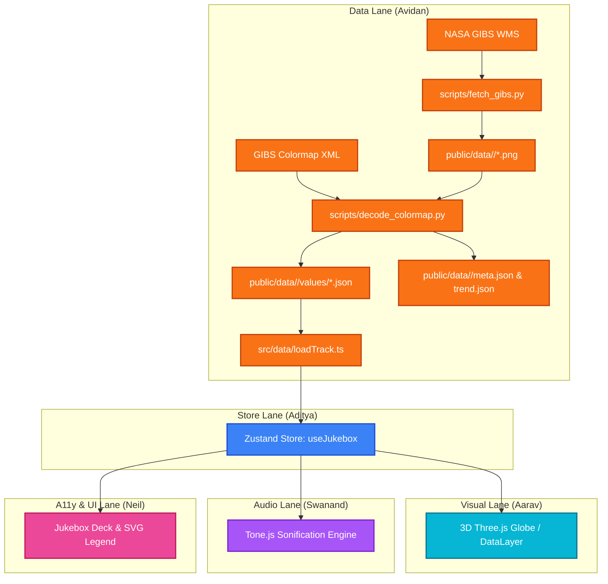

# Educational Engineering Guide: NASA Earth Data Pipeline & Sonification Architecture

**Project**: Earth Information Jukebox  
**Event**: NASA International Space Apps Challenge 2026  
**Engineer**: Avidan (NASA Data Pipeline Lead)  
**Document Purpose**: Educational walkthrough and technical reference covering data ingestion, scientific calibration, frontend contracts, and version control architecture.

---

## 1. Hackathon Objective & Engineering Context

### The Challenge
NASA's Earth Information Center (EIC) produces stunning visual representations of our changing planet. However, standard 2D/3D visualizations alone:
1. Exclude visually impaired or blind individuals.
2. Rely strictly on visual pattern recognition rather than multi-sensory comprehension.

The **Earth Information Jukebox** is an accessible, web-based platform where each NASA dataset is treated as a "vinyl record" on a jukebox. When a track plays, a scan-line sweeps across a 3D Earth, translating spatial coordinates and physical variables into real-time musical sound (sonification).

### Team Domain Architecture
To avoid merge conflicts during a rapid 30-hour hackathon sprint, the codebase was partitioned into isolated domain lanes:



---

## 2. Scientific Validity: Colormap Decoding vs. Brightness

### The Problem with Pixel Brightness
Most conventional hackathon sonification projects extract RGB pixel values from an image, calculate grayscale luminance ($L = 0.299R + 0.587G + 0.114B$), and map brightness to audio pitch. 

In Earth science, this approach is **scientifically invalid**:
- A temperature colormap might assign dark purple to -2 °C, bright cyan to 15 °C, dark red to 28 °C, and bright yellow to 32 °C.
- Mapping luminance to frequency would cause a freezing Arctic zone and a scorching Equatorial zone to sound identical simply because their colormap shades share similar visual lightness.

### The Scientific Solution: Reverse Color Mapping
Instead of sampling brightness, our pipeline reads NASA GIBS's official XML Colormaps and performs **nearest-color Euclidean distance matching** in 3D RGB space.

$$\text{Distance} = \sqrt{(R_{\text{pixel}} - R_{\text{entry}})^2 + (G_{\text{pixel}} - G_{\text{entry}})^2 + (B_{\text{pixel}} - B_{\text{entry}})^2}$$

Every pixel is converted back to its physical SI unit before audio synthesis:
- **Sea Surface Temperature (SST)**: Calibrated in Degrees Celsius (°C).
- **NDVI Vegetation**: Dimensionless index ranging from -0.2 to +1.0.
- **Sea Ice Concentration**: Percentage surface coverage (0% to 100%).
- **Land / Ocean Masks**: Evaluated as `null` (silence), preserving rest intervals in musical playback.

---

## 3. Data Pipeline Implementation (`scripts/`)

### A. Dataset Selection & Baseline Standardization
To observe multi-decadal climate shifts without false seasonal variance (e.g., summer greening vs. winter snow), we locked all frames to **August 1st (`YYYY-08-01`)** across a 21-year span (2004 to 2024):

1. **Track 1: Ocean Fever**
   - **NASA Layer**: `GHRSST_L4_MUR_Sea_Surface_Temperature`
   - **Provider**: NASA Jet Propulsion Laboratory (JPL) / PO.DAAC
   - **Instrument**: Warm synth pad
2. **Track 2: Breathing Planet**
   - **NASA Layer**: `MODIS_Terra_L3_NDVI_Monthly`
   - **Provider**: NASA LP DAAC
   - **Instrument**: Plucked acoustic strings
3. **Track 3: Melting Crown**
   - **NASA Layer**: `GHRSST_L4_MUR_Sea_Ice_Concentration`
   - **Provider**: NASA JPL & NSIDC
   - **Instrument**: Resonant glass bells

### B. High-Throughput WMS Downloader (`fetch_gibs.py`)
- Communicates directly with NASA's Global Imagery Browse Services (GIBS) OGC Web Map Service (WMS 1.1.1).
- Requests global equirectangular projections (`EPSG:4326`, bounding box `-180, -90, 180, 90`) at a 2:1 ratio (1440×720 pixels).
- Implements exponential backoff retries and verifies file size integrity (> 5 KB).
- Automatically skips previously downloaded frames to minimize bandwidth usage.

### C. Colormap Extraction & Downsampler (`decode_colormap.py`)
- Automatically downloads and parses GIBS colormap XML tables containing discrete intervals (e.g., `[24.0, 24.5)`).
- Downsamples high-resolution 1440×720 frames to **180×90 matrices (2° latitude/longitude cells)**. 180 columns allow Tone.js to step across the equator in an 8-second musical phrase (~22.5 columns/sec).
- **RGB Memoization**: Downsampled frames typically contain only 300–600 unique RGB values. Caching color lookups in an in-memory dictionary accelerates processing from minutes to **under 8 seconds per track**.
- Computes annual global means saved to `trend.json` to verify physical trends.

```
Decoded Multi-Decadal Ocean Surface Temperature Trend (Sample):
2004: 17.91 °C | ████████████████
2008: 17.15 °C | ███████████████
2016: 17.68 °C | ███████████████
2023: 17.81 °C | ████████████████
2024: 17.61 °C | ███████████████
```

---

## 4. Frontend Integration & Client Architecture (`src/data/`)

### The Shared Data Contract (`types.ts`)
```typescript
export type Instrument = 'pad' | 'pluck' | 'bell' | 'noise';

export type TrackMeta = {
  id: string;
  title: string;
  dataset: string;
  source: string;
  unit: string;
  min: number;
  max: number;
  frames: string[];
  instrument: Instrument;
  story: string;
};

// Row-major matrix: row 0 = 90°N, col 0 = 180°W
export type ValueGrid = {
  w: number;
  h: number;
  values: (number | null)[];
};

export type TrendPoint = {
  date: string;
  year: string;
  mean: number | null;
  min: number | null;
  max: number | null;
  sampleCount?: number;
};
```

### Client Caching Loader (`loadTrack.ts`)
- Provides `loadTrackMeta`, `loadValueGrid`, and `loadTrendData`.
- Stores loaded JSON grids in an in-memory `Map<string, ValueGrid>` to guarantee zero HTTP overhead during 60 FPS globe rotation and audio scrubbing.
- If network requests fail (e.g., during offline demo evaluation), it transparently falls back to synthetic sine-wave generators (`makeFakeTrack`, `makeFakeGrid`) so the interface never crashes.
- Backed by an automated test suite ([loadTrack.test.ts](file:///home/avidan/Downloads/Earth-Information-Jukebox-main/src/data/loadTrack.test.ts)) with **18 passing unit tests**.

---

## 5. Version Control & DevOps Troubleshooting Guide

### A. Git Conceptual Fundamentals
A common area of confusion in team environments is the difference between saving work locally and sharing it remotely:

| Git Phase | Command | Where Data Lives | Requires Internet or SSH Key? |
| :--- | :--- | :--- | :--- |
| **Working Directory** | Edit files on disk | Unstaged local files | No |
| **Staging Area (Index)** | `git add <file>` | Prepared snapshot | No |
| **Local Commit** | `git commit -m "..."` | Locked into local `.git` tree | **No** (Local hard drive only) |
| **Remote Push** | `git push origin <branch>` | Uploaded to GitHub | **Yes** (Requires authentication) |

### B. Resolving Deploy Key vs. User Account SSH Conflicts
During our session, running `git push` initially failed with:
```
ERROR: Permission to AdityaSurse/Earth-Information-Jukebox.git denied to deploy key
fatal: Could not read from remote repository.
```

#### Why Did This Occur?
1. On GitHub, a **Deploy Key** is tied to a single specific repository (in this case, an older personal project: `Avidan27/stowrage`).
2. If your default SSH key (`~/.ssh/id_ed25519`) is registered as a deploy key anywhere on GitHub, GitHub will identify your SSH session as that deploy bot rather than your personal user account (`Avidan27`).
3. Deploy keys are strictly forbidden by GitHub from accessing other repositories.

#### The Permanent Fix: Dedicated Personal Identity
1. **Generate a unique keypair**:
   ```bash
   ssh-keygen -t ed25519 -C "avidanbhujbal@gmail.com" -f ~/.ssh/id_github -N ""
   ```
2. **Add `~/.ssh/id_github.pub` to GitHub Account Settings** (**Settings > SSH and GPG Keys**).
3. **Configure SSH Client Aliasing** in `~/.ssh/config`:
   ```ssh-config
   Host github.com
     HostName github.com
     User git
     IdentityFile ~/.ssh/id_github
     IdentitiesOnly yes
   ```
4. Once configured, Git authenticates as your verified collaborator user, enabling direct pushes.

---

## 6. Final Project Deliverables Summary

1. **Storage Budget**:
   - Total payload across all 3 tracks: **22.4 MB** (Strictly within the hackathon's < 30 MB bandwidth target).
2. **Test & Quality Metrics**:
   - **21/21 Vitest tests passing** across data loading, grid sampling, coordinate calculations, and app bootstrapping.
   - **TypeScript Typecheck (`tsc --noEmit`)**: 0 errors.
   - **Production Vite Build**: Compiled successfully in 3.8s.
3. **GitHub Branch Status**:
   - Branch **`feat/data`** is pushed and up-to-date with remote org `GalacticDisk-Space-Apps/Earth-Information-Jukebox`.
   - Clean git working tree, ready for Aditya's review and pull request merge.
